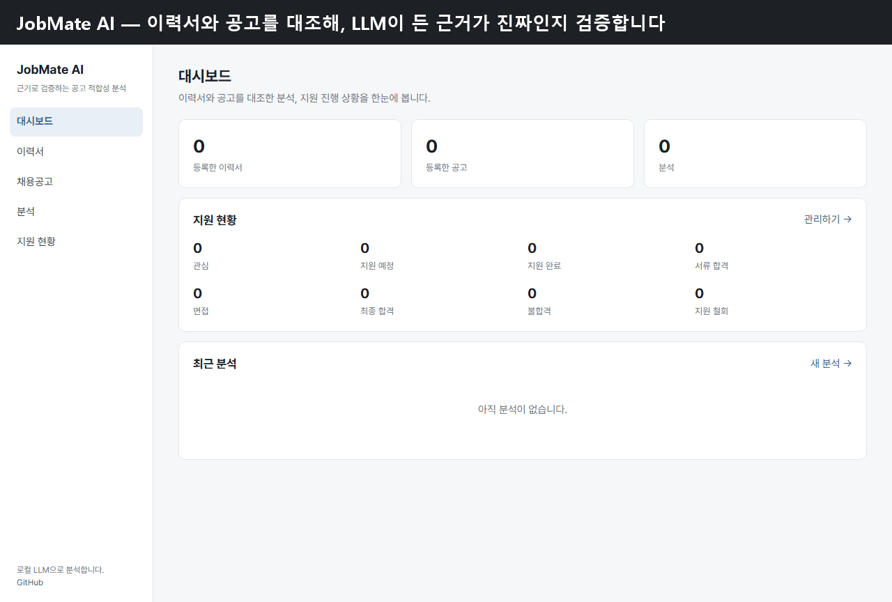
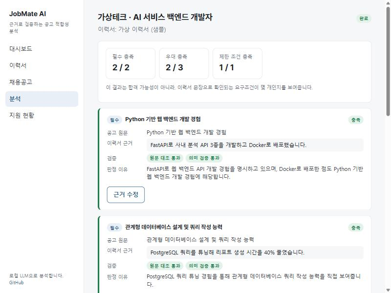
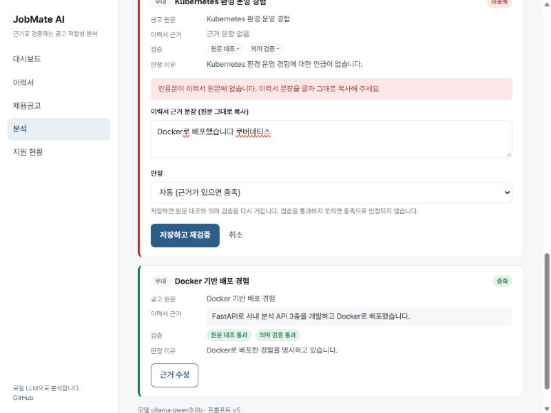

# JobMate AI

> **LLM이 제시한 근거가 실제로 맞는지 검증하고, 그 정확도를 측정하는** 채용공고 적합성 분석 Agent



| | |
|---|---|
| **무엇을 만들었나** | 이력서와 채용공고를 넣으면 요구조건마다 이력서 근거 문장을 인용해 충족 여부를 판정하는 웹 서비스. LangGraph 파이프라인이 인용문을 **코드로 원문과 대조**하고, **LLM으로 한 번 더** 조건을 뒷받침하는지 확인합니다. 사용자가 근거를 고쳐도 같은 검증을 다시 거칩니다. |
| **무엇을 발견했나** | 평가 중 검증 단계가 오히려 **맞는 답을 버리게 만드는 결함**(재시도 피드백이 포기를 유도)을 찾아 고쳤습니다. 개발 데이터에서는 검증이 지어낸 인용·근거 없는 충족 판정을 모두 걸러냈지만, **보지 않은 test에서는 차이가 없었고** 그대로 기록했습니다. |
| **어떻게 검증했나** | 가상 이력서 25케이스·174개 요구조건을 라벨링해 easy / dev / test로 나누고, 프롬프트는 dev만 보고 고친 뒤 test는 한 번만 실행했습니다. 한 번 본 test는 폐기하고 새로 만들었습니다. 백엔드 테스트 129개와 CI가 매 커밋마다 돕니다. |

로컬 LLM(`qwen3:8b`, Ollama)으로 동작하며 API 비용이 들지 않습니다. · 설계: [docs/design.md](docs/design.md) · 파이프라인: [docs/agent-design.md](docs/agent-design.md) · 평가: [evals/README.md](evals/README.md)

## 진행 상황

| 단계 | 내용 | 상태 |
|---|---|---|
| 01 기반 | FastAPI, PostgreSQL, Docker Compose, Alembic 마이그레이션, 테스트, CI | ✅ |
| 02 분석 파이프라인 | LangGraph: Parser → Matcher → Span Check(코드) → Semantic Check(LLM) → Report | ✅ |
| 03 평가 | 25케이스·174개 요구조건(easy/dev/test 분리), 라벨 기준표, 검증 단계별 비교 | ✅ (로컬 모델) |
| 04 API | 이력서(텍스트·PDF)·공고·분석·지원현황, 근거 수정 → 재검증 | ✅ |
| 05 화면 | React + TypeScript + Vite, nginx로 서비스 | ✅ |
| 06 배포 | 시연 GIF ✅ · 공개 데모 서버 ⏳ | 🔄 |

## 평가 결과 요약

로컬 `qwen3:8b`, 보지 않은 test 5케이스·40개 요구조건, 프롬프트 v5 · 상세: [evals/README.md](evals/README.md)

| 시스템 | 근거 없는 충족 판정 | 지어낸 인용 | 오탐 | 충족 재현율 | LLM 호출 |
|---|---:|---:|---:|---:|---:|
| A. 검증 없음 | 4.3% | 0.0% | 0.0% | 95.7% | 5 |
| C. 원문 대조 + 의미 검증 | 4.3% | 0.0% | 0.0% | 95.7% | 10 |

**보지 않은 test에서는 검증 단계가 차이를 만들지 못했습니다.** 다듬은 프롬프트의 8B 모델이 검증으로 잡을 오류를 거의 내지 않았기 때문입니다.
모델이 실제로 틀린 dev에서는 검증이 근거 없는 충족 판정을 10.3% → 0%, 지어낸 인용을 5.1% → 0%로 모두 걸러냈습니다(조정에 쓴 데이터라 낙관적).

평가 과정에서 검증 단계가 오히려 맞는 답을 버리게 만든 결함(재시도 피드백이 포기를 유도)을 찾아 고쳤고,
한 번 본 test는 dev로 옮긴 뒤 새 test를 만들어 다시 측정했습니다. 이 기록은 [evals/README.md](evals/README.md)에 그대로 남겨 두었습니다.

## 화면

| 분석 결과 | 근거 수정 → 재검증 |
|---|---|
|  |  |

맨 위 시연 GIF는 [scripts/demo/record_demo.py](scripts/demo/record_demo.py)가 실행 중인 사이트를 Playwright로 조작해 만듭니다. 화면이 바뀌면 다시 실행하면 됩니다.

- **분석 결과:** 요구조건마다 공고 원문, 이력서 근거, 원문 대조·의미 검증 통과 여부, 판정 이유를 보여줍니다. 점수 대신 유형별 충족 수를 보여주고, 학력·경력 같은 제한 조건 미충족은 따로 경고합니다.
- **근거 수정:** 사용자가 고친 인용문도 원문 대조와 의미 검증을 다시 거칩니다. 이력서에 없는 문장(위 오른쪽 화면)은 저장되지 않고, 비슷한 원문 줄이 있으면 제안합니다.
- **이력서 등록:** 텍스트를 붙여넣거나 PDF에서 추출한 뒤 확인·수정해서 저장합니다. 연락처는 저장 전에 가려지고 원본 PDF는 저장하지 않습니다.

## 실행

Docker와 [Ollama](https://ollama.com)가 있으면 됩니다. 분석은 PC의 로컬 모델로 돌아갑니다(RTX 3060 12GB 기준 공고 1건 20~40초).

```bash
ollama pull qwen3:8b
docker compose up -d --build
```

- 웹: http://localhost:3000
- API 문서: http://localhost:8000/docs

컨테이너가 시작될 때 `alembic upgrade head`로 스키마가 자동 적용됩니다.
API 컨테이너는 `host.docker.internal:11434`로 PC의 Ollama에 접속합니다(`OLLAMA_BASE_URL`로 변경 가능).

### API

| Method | Path | 설명 |
|---|---|---|
| POST | `/api/resumes/extract` | PDF에서 텍스트 추출(저장하지 않음) |
| POST · GET · DELETE | `/api/resumes` | 이력서 등록(연락처 마스킹)·조회·삭제 |
| POST · GET · DELETE | `/api/jobs` | 공고 등록·조회·삭제. 링크는 기록만 하고 가져오지 않음 |
| POST | `/api/analyses` | 분석 시작(백그라운드, 202) |
| GET | `/api/analyses/{id}` | 결과: 충족 현황, 경고, 요구조건별 근거와 검증 결과 |
| PATCH | `/api/analyses/{id}/evidence/{eid}` | 근거 수정 → 원문 대조·의미 검증 재실행 |
| POST · GET · PATCH · DELETE | `/api/applications` | 지원 현황 |
| GET | `/api/dashboard` | 집계 |

### 명령줄 분석 · 평가

```bash
cd backend
python -m app.cli samples/resume_sample.txt samples/job_sample.txt   # 분석 1건
python -m app.evals.run --split dev                                  # 평가
```

### 테스트

백엔드 테스트는 실제 PostgreSQL에서 돌고, 개발 데이터와 분리된 `jobmate_test` DB를 자동으로 만듭니다. LLM은 미리 정한 응답으로 대체해 비용이 들지 않습니다.

```bash
docker compose up -d db
cd backend && pip install -r requirements-dev.txt && pytest -q       # 129개
cd frontend && npm ci && npm run lint && npm run build
```

CI(GitHub Actions)는 백엔드 테스트, 프론트엔드 빌드, 그리고 전체 스택을 Docker로 띄워 웹·API 응답까지 확인합니다.

## 구조

```
backend/
  app/
    api/           HTTP API — resumes, jobs, analyses(근거 수정 재검증), applications, dashboard
    services/      저장된 이력서·공고로 파이프라인 실행, 사용자 수정 재검증
    pipeline/      LangGraph 파이프라인 — 마스킹, 공고 파싱, 매칭, 원문 대조(+보정), 의미 검증, 리포트
    llm/           LLM 클라이언트 인터페이스 — Ollama(로컬), Fake(테스트)
    evals/         평가 데이터 로더, 지표, 실행기
    models.py      resumes · job_postings · analyses · match_evidence · applications
  migrations/      Alembic 마이그레이션
  tests/           API, 파이프라인, 원문 대조·마스킹, 평가 데이터 무결성, 스키마
frontend/          React + TypeScript + Vite (nginx로 서비스, /api는 API 컨테이너로 전달)
evals/             평가 케이스(easy/dev/test), 라벨 기준표, 결과
docker-compose.yml PostgreSQL 16 + API + Web
```

## 데이터·개인정보 원칙

- 이력서 **원본 PDF는 저장하지 않고**, 연락처를 가린 텍스트(`masked_text`)만 저장합니다. 모델에도 가린 텍스트만 보냅니다.
- 이름은 패턴으로 확실히 찾을 수 없어 자동으로 가리지 않습니다. 공개 데모는 **샘플 이력서 전용**으로 운영합니다.
- 평가 데이터는 가상 이력서와 재작성한 공고만 사용합니다.

## Stack

Python 3.12 · FastAPI · LangGraph · Pydantic · SQLAlchemy 2 · Alembic · PostgreSQL 16 · PyMuPDF · Ollama · React 19 · TypeScript · Vite · nginx · Docker Compose · pytest · Ruff · GitHub Actions
(예정: Claude API로 모델 비교 평가)
