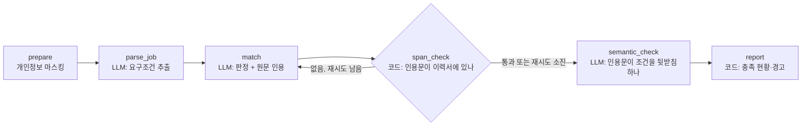

# 분석 파이프라인 설계 (Phase 02)

코드: `backend/app/pipeline/`, 테스트: `backend/tests/test_pipeline.py`, `test_span_and_privacy.py`

## 흐름

| 노드 | 방식 | 하는 일 |
|---|---|---|
| prepare | 코드 | 이메일·전화번호·주민번호를 `[EMAIL]` 등으로 치환. **모델은 원본 연락처를 보지 않는다** |
| parse_job | LLM | 필수·우대·제한 조건을 하나씩 분리, 공고 원문 인용(`job_quote`)도 원문 대조 |
| match | LLM | 요구조건마다 판정(met / not_met / insufficient) + 이력서 원문 인용 |
| span_check | **코드** | 인용문이 이력서에 그대로 있는지 대조. 공백·줄바꿈·글머리 기호·전각 문자 차이만 허용 |
| semantic_check | LLM | 원문 대조를 통과한 `met`만 다시 검증. "인용문만 보고 조건 충족을 확인할 수 있는가" |
| report | 코드 | 유형별 충족 수, 제한 조건 미충족 경고 |

## 왜 검증을 두 단계로 나눴나

로컬 모델 실험에서 실제로 나온 오류 두 종류가 각 단계의 이유다.

1. **지어낸 인용** — 이력서에 없는 문장을 근거로 제시 → `span_check`가 잡는다.
   모델이 자기 인용을 스스로 검증하게 하면 같은 착각을 반복하므로 **문자열 대조(코드)** 로 한다.
2. **실제로 있지만 무관한 인용** — "SQL 활용 능력"의 근거로 "Python과 Pandas로 데이터를 정제했습니다"를 제시.
   문장은 이력서에 실제로 있어서 원문 대조를 통과한다 → `semantic_check`가 잡는다.

## 재시도와 강등

- **코드 보정 먼저:** 모델이 "프로젝트명 · 2024.08 - 실제 문장"처럼 제목·날짜를 붙여 인용하면, 붙은 조각 중 원문에 **글자 그대로 있는 부분**만 골라 인용문으로 쓴다(`span.repair_quote`). 새 문장을 만들거나 고쳐 쓰지 않으므로 지어낸 인용이 통과할 수 없다.
- 그래도 실패한 항목만 피드백과 함께 `match`로 돌려보낸다. 피드백에는 어떤 인용문이 원문과 달랐는지와 **가장 비슷한 이력서 줄**(`span.closest_line`)을 적는다.
- 최대 시도 횟수(`MAX_MATCH_ATTEMPTS`, 기본 3)를 넘기면 그 항목은 **근거 부족(insufficient)으로 강등**하고 인용문을 비운다. 검증되지 않은 근거를 결과에 남기지 않는다.
- 응답에서 빠진 requirement_id도 같은 루프로 다시 묻는다.

### 평가에서 찾은 결함 (v3 → v4)

v3의 재시도 피드백은 "이력서 문장을 그대로 복사하거나, **근거가 없으면 빈 문자열과 not_met으로 답하세요**"였다.
모델이 제목과 본문을 이어 붙여 인용했다가 원문 대조에 실패하자, 인용을 고치는 대신 **맞는 판정 5개를 전부 not_met으로 바꿨다.**
검증 단계가 정답을 오답으로 만든 것이다. v4는 포기를 권하지 않고 가장 비슷한 원문 줄을 보여주며, 코드 보정으로 재시도 자체를 줄였다.

## 평가용 단계별 스냅샷

`run_matching_stages()`는 한 번의 실행에서 `first_match`(검증 없음), `after_span`, `after_semantic` 시점의 결과와
단계별 LLM 호출 수를 함께 돌려준다. 평가는 이 세 시점을 비교하므로, 같은 모델 출력 위에서 검증의 효과만 본다.

## 모델 교체

노드는 `LLMClient.structured(system, user, schema)` 하나에만 의존한다.

| 구현 | 용도 |
|---|---|
| `OllamaClient` | 개발 — 로컬 `qwen3:8b`, JSON 스키마로 출력 형식 강제 |
| `FakeLLM` | 테스트 — 답을 미리 정해 두고 호출 내용을 기록. CI 비용 0 |
| Claude (예정) | Phase 03 최종 평가 |

## 프롬프트 버전

`prompts.PROMPT_VERSION`을 리포트에 기록한다. 평가 결과를 비교할 때 어떤 프롬프트였는지 추적하기 위해서다.

| 버전 | 변경 | 이유 |
|---|---|---|
| v1 | 최초 | |
| v2 | 공고 파싱에 필수·우대 모두 추출, type 결정 규칙 명시 | v1에서 샘플 공고의 우대 사항 3개가 통째로 빠지고 모든 항목이 constraint로 분류됨 |
| v3 | 의미 검증이 인용문이 나온 **이력서 줄과 섹션 제목**을 함께 봄 | 기술 목록에서 "Git" 한 단어만 인용하면 근거가 아니라고 거부함 |
| v4 | 인용은 한 줄 안에서·제목/날짜 없이, 재시도 피드백에서 포기 유도 문구 삭제 | 위 결함 |
| v5 | 기술 목록 인정, 관심·학습 중 불인정, 경력 연수는 같은 직무만 — 매칭과 의미 검증에 **같은 규칙** | 매칭만 기술 목록을 근거로 인정하지 않아 재현율이 떨어지고, 서비스 기획 3년을 개발 경력으로 셈 |

## 아직 안 한 것

- 사용자 근거 수정 후 재검증(LangGraph interrupt) — Phase 04 API와 함께
- 결과 DB 저장 — Phase 04
- Claude 클라이언트와 모델 비교 평가 — API 크레딧 준비 후
