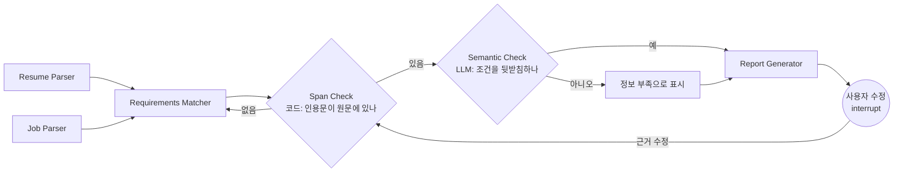

# JobMate AI — 설계 v2

> **LLM이 내놓은 근거가 실제로 맞는지 검증하고, 그 정확도를 측정하는** 채용공고 적합성 분석 Agent
> 이력서·채용공고는 소재이고, 이 프로젝트의 핵심은 **근거 검증과 평가**다.

v1(다른 AI와 만든 초안)에서 바뀐 점은 맨 아래 [변경 이력](#변경-이력-v1--v2)에 정리했다.

---

## 1. 이 프로젝트가 포트폴리오에서 맡는 역할

| 기존 포트폴리오 | JobMate가 채우는 것 |
|---|---|
| FRIMA — ML·SHAP·평가 검증 (팀) | **혼자 처음부터 끝까지** 설계·구현·배포한 프로젝트 |
| AI 면접관·강사 Agent — LangGraph (팀, 부트캠프) | **LLM 출력의 정확도·신뢰성을 수치로 측정**한 경험 |
| BookMuseum — Spring 백엔드 (팀) | FastAPI 백엔드 + 테스트 + CI + **동작하는 데모** |

이어지는 이야기: FRIMA에서 "SHAP으로 판정 근거를 보여주고 평가 방식까지 의심했다" → JobMate에서 "LLM이 낸 근거가 진짜인지 측정했다".

**AI 면접관 Agent와의 차이** (면접 대비): 면접관 Agent는 *질문을 만드는* 생성 흐름, JobMate는 *주장의 근거를 검증하는* 신뢰성 문제. 이력서는 공통 소재일 뿐이다.

---

## 2. 성공 기준 (README 첫 화면에 올라갈 숫자)

1. **근거 정확도** — 매칭 근거로 인용한 문장이 원문 이력서에 실제로 있고, 그 요구조건을 뒷받침하는 비율
2. **근거 없는 매칭 비율** — 원문에 없거나 무관한 근거로 "충족" 판정한 비율 (낮을수록 좋음)
3. **요구조건 추출 재현율** — 공고의 필수·우대 조건 중 빠짐없이 뽑아낸 비율

→ **단일 프롬프트 베이스라인 vs JobMate 파이프라인** 비교표로 제시
(예: "근거 없는 매칭 18% → 3%"). FRIMA의 LR vs LightGBM, 행 분할 vs 점포 분할 비교와 같은 구조.

---

## 3. 분석 파이프라인 (LangGraph)



| 노드 | 방식 | 비고 |
|---|---|---|
| Resume Parser | PyMuPDF 추출 → LLM 구조화 (Pydantic) | 추출 텍스트를 **사용자가 수정**할 수 있게 함 (한글 2단·표 레이아웃 대비) |
| Job Parser | LLM 구조화 (Pydantic) | 필수 / 우대 / 경력 / 학력 / 근무조건 |
| Requirements Matcher | LLM | 요구조건마다 판정 + **원문 인용(span)** 필수 |
| **Span Check** | **코드 (문자열 대조)** | 인용문이 원문에 없으면 Matcher로 되돌려 재시도 (최대 N회) |
| Semantic Check | LLM | 인용문이 조건을 실제로 뒷받침하는지만 판단 |
| Report Generator | LLM + 템플릿 | 충족 이유, 부족 역량, 보완 방향 |
| 사용자 수정 | LangGraph interrupt | 수정한 근거부터 다시 검증 |

**LangGraph를 쓰는 이유** (면접 대비): 검증 실패 시 재시도 루프, 사용자 수정 후 중간 지점부터 재개 — 단순 함수 체인으로는 표현이 번거로운 분기와 상태.

**기술명 정규화 (선택)**: "PyTorch" ↔ "딥러닝 프레임워크"처럼 표현이 다른 기술을 사전 + 임베딩 유사도로 매칭. 벡터DB 없이 임베딩 경험을 넣는 지점.

---

### LLM 구성 — 로컬 + Claude 혼합

| 용도 | 모델 | 이유 |
|---|---|---|
| 개발·반복 실험 | **로컬 LLM** (Ollama, 7~14B 한국어 가능 모델, RTX 3060 12GB) | 비용 0, 이력서 데이터가 외부로 나가지 않음 |
| 최종 평가 | **Claude** (`claude-opus-5-5`, Batch API) | 최고 품질 기준선, Citations 기능으로 인용 위치 확보 |

- 노드는 **LLM 클라이언트 인터페이스**만 의존하고, 로컬/Claude 구현을 설정으로 바꿔 끼운다.
- 테스트·CI는 **저장해 둔 응답(fixture)** 으로 돌아 API 비용이 들지 않는다.
- 평가 결과는 **모델 × 검증 유무** 2×2 표로 제시한다 → "어떤 모델을 쓰든 검증 단계가 효과가 있다"를 보여준다.
- 작은 모델일수록 근거를 지어내기 쉬우므로, 검증 단계의 효과가 더 분명하게 드러날 것으로 예상한다 (측정으로 확인).

---

## 4. 결과 표시

단일 점수 대신 **항목별 충족 현황**을 먼저 보여준다.

```
필수 조건  3 / 4 충족   ⚠ 경력 3년 이상 — 미충족 (별도 경고)
우대 조건  2 / 3 충족
근거 확인  5건 (원문 인용 · 검증 완료)
```

- 학력·경력 등 **명확한 제한 조건 미충족은 점수와 분리해 경고**
- 점수를 보여준다면 "합격 가능성이 아니다"를 화면에 명시하고 계산식을 공개
- 요구조건 카드: 공고 근거 / 이력서 근거(인용) / 판정 / AI 설명 / 한계

---

## 5. 개인정보 · 비용 · 저작권

| 위험 | 대응 |
|---|---|
| 실제 이력서가 LLM API로 전송·DB에 저장 | 원본 저장 안 함(기본), 전송 전 이름·연락처·주소 마스킹, 분석 결과만 저장 |
| 공개 데모에 타인이 실제 이력서 업로드 | 공개 데모는 **샘플 이력서 전용** 모드 |
| 공개 데모 API 비용·악용 | 미리 계산한 결과 제공 또는 사용자 키 입력(BYOK) + 요청 횟수 제한 |
| 채용공고 원문 저작권 | 평가 데이터의 공고는 **재작성·창작**, 원문은 저장소에 넣지 않음 |
| 저장소 공개 | 가상 이력서만, `.env`·API 키·실제 지원 기록 커밋 금지 |
| 데모 서버 중단 | **시연 영상**을 README에 고정 |

---

## 6. 평가 설계 (`evals/`)

- 케이스 **20~30건**: 가상 이력서 × 재작성 공고
- 반드시 포함: 필수 조건 누락, 이력서에 없는 기술(환각 유도), 경력 연수 부족, 유사하지만 다른 기술(Java ↔ JavaScript 등), 표현만 다른 같은 기술
- **라벨 기준표**(`evals/LABELING.md`)를 먼저 쓰고 라벨링
- 지표 계산은 코드로 자동화, 결과는 `evals/results/`에 버전별 저장
- 비교 대상: ① 단일 프롬프트 베이스라인 ② 파이프라인(Span Check 없음) ③ 전체 파이프라인

---

## 7. 개발 순서

평가 결과가 핵심 성과이므로 **파이프라인과 평가를 화면보다 먼저** 만든다.
각 단계가 끝날 때마다 README에 쓸 수 있는 결과물이 남게 한다.

| 단계 | 내용 | 완료 기준 |
|---|---|---|
| **01 기반** | 저장소, FastAPI 골격, PostgreSQL, Docker Compose, 마이그레이션, CI | 서버 실행, DB 연결, `/health` 응답, CI 통과 |
| **02 분석 파이프라인** | Parser·Matcher·Span Check·Semantic Check·Report (LangGraph + Pydantic) | 이력서 1 + 공고 1 → 검증된 JSON 결과 |
| **03 평가** | 평가 데이터 20~30건, 라벨 기준표, 베이스라인 비교, 지표 자동 계산 | README에 비교표 게시 ← **여기까지만 해도 포트폴리오 가치 확보** |
| 04 API·저장 | 이력서·공고·분석·지원현황 API, 근거 수정 API, 테스트 | Pytest 통과, 근거 수정 → 재검증 동작 |
| 05 화면 | React + TypeScript + Vite | 등록 → 분석 → 근거 확인·수정 → 지원현황 |
| 06 배포 | 배포, 샘플 전용 데모, 시연 영상, 문서 | 공개 데모 링크 + 영상 + `docs/` 완성 |

---

## 8. 저장소 완성 기준

- `README.md` — 문제 정의, **평가 비교표**, 데모·영상 링크, 실행 방법
- `docs/architecture.md`, `docs/agent-design.md`(노드·상태·재시도·interrupt), `docs/privacy.md`
- `evals/` — 케이스, 라벨 기준표, 결과
- `tests/`, `.github/workflows/`, `docker-compose.yml`

---

## 변경 이력 (v1 → v2)

| v1 | v2 | 이유 |
|---|---|---|
| "AI 채용공고 분석 서비스" 중심 | **근거 검증·평가** 중심 | 면접관 Agent와 주제 중복 회피, 포트폴리오 빈자리(LLM 평가) 채우기 |
| Evidence Validator = LLM | **Span Check(코드) + Semantic Check(LLM)** | LLM이 LLM을 검증하는 한계, 결정적 검증이 강점 |
| 단방향 노드 흐름 | 재시도 루프 + 사용자 수정 interrupt | LangGraph 사용 근거 |
| 적합도 점수(가중치 70/20/10) 중심 | 항목별 충족 현황 + 제한 조건 경고 | 합격 가능성 오해, 가중치 근거 부족 |
| 평가 20건 | 20~30건 + 라벨 기준표 + **베이스라인 비교** | 수치의 신뢰성, 비교 스토리 |
| React(Phase 04) → 평가(Phase 05) | **평가(03) → API(04) → 화면(05)** | 핵심 성과를 먼저 확보, 중도 중단 위험 감소 |
| 개인정보 원칙만 언급 | 마스킹·비저장·샘플 데모·BYOK·영상 | 공개 데모 운영 위험 |
| LLM 미정 ("API 기반 생성형 AI") | 로컬 LLM(개발) + Claude(최종 평가), 모델 × 검증 2×2 비교 | 비용 최소화 + 비교표로 검증 효과 일반화 |
